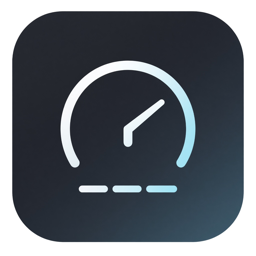

<p align="center">
  
</p>

# PulseBar

**Local-only** macOS menu-bar system monitor.  
Live CPU · Memory · Temperature · Network · utilities — with **zero telemetry**.


[](https://github.com/Hevarh1/PulseBar/releases/latest/download/PulseBar.app.zip)

**[↓ Download PulseBar.app.zip](https://github.com/Hevarh1/PulseBar/releases/latest/download/PulseBar.app.zip)** · [All releases](https://github.com/Hevarh1/PulseBar/releases)

## Features

- **Menu bar** — TEM / MEM / CPU (and optional network, battery, uptime)
- **Dashboard popover** — live graphs, sensors, and a full utility grid (no scrolling required)
- **Honest sensors** — Activity Monitor–style memory; AppleSMC temperature (not fake thermal enums)
- **Utilities** — Clean Keyboard / Screen, Dark Mode, Empty Trash, Lock, Hide Dock/Desktop, Keep Awake, Meeting Mode, and more
- **Private by design** — no accounts, no analytics, no network for metrics

## Requirements

- macOS **14** (Sonoma) or later
- [Xcode](https://developer.apple.com/xcode/) or Command Line Tools (`xcode-select --install`) — only if building from source
- Apple Silicon or Intel Mac

## Install

### Option A — Download release (recommended)

1. Download **[PulseBar.app.zip](https://github.com/Hevarh1/PulseBar/releases/latest/download/PulseBar.app.zip)**
2. Unzip and move `PulseBar.app` into **Applications**
3. Open once (right-click → **Open** if Gatekeeper warns)

### Option B — Build a `.app`

```bash
git clone https://github.com/Hevarh1/PulseBar.git
cd PulseBar
chmod +x scripts/package-app.sh
./scripts/package-app.sh
open dist/PulseBar.app
```

Then optionally drag `dist/PulseBar.app` into **Applications**.

### Option C — Run from source

```bash
git clone https://github.com/Hevarh1/PulseBar.git
cd PulseBar
swift run PulseBar
```

> When you use `swift run`, macOS may attribute **Accessibility** to **Terminal** (not PulseBar). Prefer Option A or B for Clean Keyboard and Launch at Login.

## First launch permissions

| Feature | Permission |
|---------|------------|
| Clean Keyboard (block keys) | **Privacy & Security → Accessibility** — enable PulseBar (or Terminal if using `swift run`) |
| Dark Mode / Empty Trash / Lock fallback | **Automation** (prompted on first use) |

PulseBar never phones home. Permissions are only for local system controls you trigger.

## Usage

1. Look for **TEM / MEM / CPU** in the menu bar.
2. Click any of them to open the dashboard.
3. Use **Preferences** (gear) for sampling interval, units, and which metrics appear in the menu bar.
4. Quit from the dashboard footer or Force Quit if needed.

## Development

```bash
swift build          # debug build
swift run PulseBar   # run
swift test           # unit tests
./scripts/package-app.sh   # release .app in dist/
```

Project layout:

```
PulseBar/
  App/           # NSApplication, menu bar
  Monitoring/    # CPU, memory, thermal, disk, network, GPU, battery
  Views/         # SwiftUI dashboard
  Controls/      # Dock, desktop, clean modes, utilities
  Resources/     # AppIcon.png
```

## Privacy

- Metrics and preferences stay on your Mac.
- No crash reporters, no update pings, no accounts.
- Optional Automation / Accessibility only when you use those utilities.

## License

[MIT](LICENSE) — free to use, modify, and redistribute.
