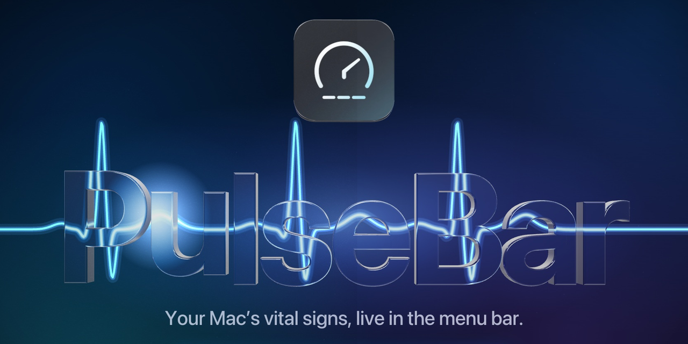
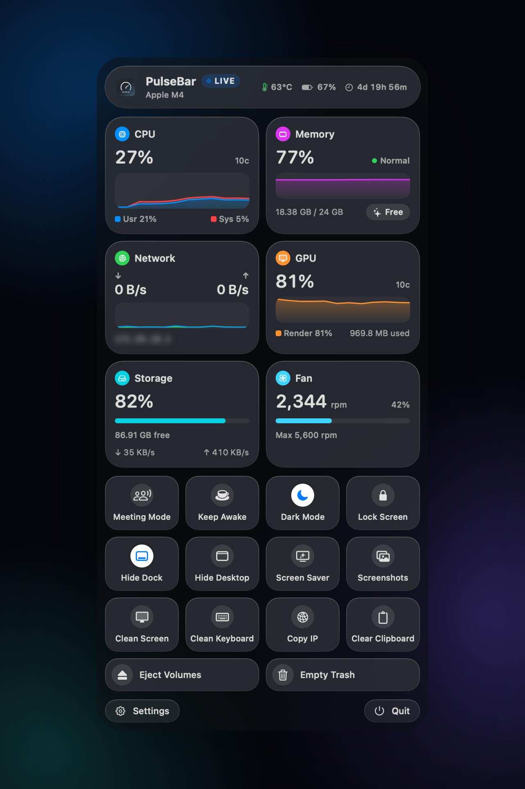

<p align="center">
  
</p>

<p align="center">
  A free, local-only system monitor for the macOS menu bar.<br>
  CPU, memory and temperature at a glance, a live dashboard one click away, and 14 Mac tools built in.
</p>

<p align="center">
  <a href="https://github.com/Hevarh1/PulseBar/releases/latest/download/PulseBar.app.zip"><b>⬇&nbsp; Download PulseBar</b></a>
  &nbsp;·&nbsp;
  <a href="https://github.com/Hevarh1/PulseBar/releases">All releases</a>
</p>

<p align="center">
  <a href="https://github.com/Hevarh1/PulseBar/releases/latest"></a>
  
  
  
  <a href="LICENSE"></a>
</p>

<p align="center">
  
</p>

## Why PulseBar

- **See it at a glance.** Temperature, memory and CPU sit in your menu bar and update live.
- **Open it from anywhere.** Click a reading, or press **⌃⌘P** in any app, to drop down the full dashboard.
- **Do the small jobs in one click.** Keep the Mac awake, lock it, hide the Dock, wipe the screen, and more.
- **Keep your data.** No accounts and no analytics. Your stats never leave your Mac.

## What's inside

<table>
<tr>
<td valign="top">

**In the menu bar**
Temperature, memory and CPU by default. Network rate, battery level and uptime are one switch away in Settings.

**The dashboard**
Live graphs for CPU (user and system), memory (with a one-click **Free** button), network and GPU, plus storage and fan speed. MacBook Pros and other Macs with fans get a Fan tile showing each fan's RPM and how hard it's working; fanless Macs like the MacBook Air don't show it. Every section can be shown or hidden.

**Honest numbers**
Memory is counted the way Activity Monitor counts it. Temperature and fan speed come straight from the Mac's System Management Controller (AppleSMC), not a rough thermal state. GPU use comes from the GPU driver's own statistics.

**Native design**
On macOS 26 the dashboard's Liquid Glass tiles float over the desktop like Control Center. macOS 14 and 15 get a frosted panel.

**Safe updates**
Settings can check GitHub Releases and install a new version for you. Before it replaces the app, PulseBar checks that the download is signed with PulseBar's Developer ID.

</td>
<td valign="top" width="340">

</td>
</tr>
</table>

### 14 one-click tools

| Tool | What it does |
|------|--------------|
| **Meeting Mode** | Hides desktop icons and keeps the Mac awake for an hour |
| **Keep Awake** | Stops the Mac sleeping for 30 minutes, 1 hour, or until you turn it off |
| **Dark Mode** | Switches the system between light and dark |
| **Lock Screen** | Locks the Mac right away |
| **Hide Dock** | Turns Dock auto-hide on or off |
| **Hide Desktop** | Hides or shows the icons on your desktop |
| **Screen Saver** | Starts the screen saver |
| **Screenshots** | Opens your screenshots folder |
| **Clean Screen** | Turns every display black so smudges are easy to see and wipe. Hold **Esc** for 2 seconds to exit |
| **Clean Keyboard** | Blocks key presses so you can wipe the keyboard. Hold **Esc** for 2 seconds to exit |
| **Copy IP** | Copies your local IP address |
| **Clear Clipboard** | Empties the clipboard |
| **Eject Volumes** | Ejects all external drives, after asking first |
| **Empty Trash** | Empties the Trash |

## Install

1. Download **[PulseBar.app.zip](https://github.com/Hevarh1/PulseBar/releases/latest/download/PulseBar.app.zip)**.
2. Unzip it and move `PulseBar.app` into **Applications**.
3. Open it. PulseBar is signed and notarized by Apple, so macOS only asks you to confirm once that you want to open an app from the internet.

Look for **TEM · MEM · CPU** in your menu bar.

**Requirements:** macOS 14 (Sonoma) or later. The download is built for Apple Silicon. On an Intel Mac, build it from source (below).

### Permissions

PulseBar only asks for these when you first use the tool that needs them.

| Tool | Permission |
|------|------------|
| Clean Keyboard | **System Settings → Privacy & Security → Accessibility** (turn on PulseBar) |
| Dark Mode, Empty Trash, Lock Screen fallback | **Automation**, prompted on first use |

## Using PulseBar

- **Open the dashboard:** click TEM, MEM or CPU in the menu bar, or press **⌃⌘P** (Control-Command-P) in any app. Press it again to close.
- **Settings** (gear at the bottom of the dashboard): choose which readings appear in the menu bar and dashboard, the refresh intervals, °C or °F, Launch at Login, the ⌃⌘P shortcut, and automatic update checks.
- **Quit** from the button at the bottom of the dashboard.

## Privacy

- Metrics and preferences stay on your Mac.
- No accounts, analytics or crash reporters.
- The only network request is the optional update check, which talks to GitHub Releases. You can turn it off in Settings.
- Accessibility and Automation are only used for the tools you trigger.

## Build from source

You need Xcode or the Command Line Tools (`xcode-select --install`).

```bash
git clone https://github.com/Hevarh1/PulseBar.git
cd PulseBar
./scripts/package-app.sh    # builds dist/PulseBar.app
open dist/PulseBar.app
```

Or run it straight from the package:

```bash
swift run PulseBar
```

> With `swift run`, macOS gives Accessibility to **Terminal** instead of PulseBar, so use the packaged app for Clean Keyboard and Launch at Login.

### Development

```bash
swift build                 # debug build
swift test                  # unit tests
./scripts/package-app.sh    # release .app in dist/
```

```
PulseBar/
  App/          app delegate, menu bar item, dashboard panel
  Monitoring/   CPU, memory, temperature, disk, network, GPU, battery readers
  Models/       settings and metric types
  Views/        SwiftUI dashboard and settings
  Controls/     Dock, desktop, clean modes and the other tools
  Utilities/    formatting, global shortcut, updater
  Resources/    app icon
PulseBarTests/  unit tests
```

Optional local Xcode project (ignored by git):

```bash
python3 scripts/generate_xcodeproj.py   # writes PulseBar.xcodeproj
```

### Releasing (maintainers)

Releases are tag-driven. Pushing a `v*` tag runs [release.yml](.github/workflows/release.yml), which:

1. Sets the app version from the tag.
2. Builds, signs with Developer ID, notarizes and staples `PulseBar.app.zip`. This needs the `DEVELOPER_ID_P12_BASE64`, `DEVELOPER_ID_P12_PASSWORD`, `NOTARY_APPLE_ID`, `NOTARY_PASSWORD` and `NOTARY_TEAM_ID` repository secrets, and the workflow refuses to publish an unsigned build.
3. Publishes a GitHub Release with notes generated from the commits since the previous tag.

```bash
git tag v1.4.0
git push origin v1.4.0
```

Installed copies pick the release up through **Settings → Updates**. Pull requests and pushes to `main` run [ci.yml](.github/workflows/ci.yml) (`swift build` and `swift test`) and never publish a release.

## Feedback

Found a bug or want a tool added? [Open an issue](https://github.com/Hevarh1/PulseBar/issues). Pull requests are welcome.

## License

[MIT](LICENSE). Free to use, modify and share.
